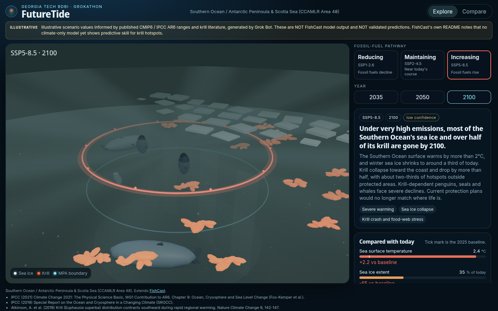

# FutureTide

A 3D Southern Ocean simulator for krill, sea ice, and marine protected areas.

<!-- screenshot: docs/screenshot.png — embed when the running app is captured

-->

## About

FutureTide is an interactive 3D Southern Ocean simulator showing how fossil-fuel pathways could affect sea ice, Antarctic krill, predators, and krill drifting outside CCAMLR marine protected areas. Built for the Georgia Tech BDBI Grokathon.

## Connection to BDBI FishCast

FutureTide extends [FishCast](https://github.com/gt-big-data/fish-cast) (Georgia Tech BDBI). FishCast models Antarctic krill against marine protected areas using KRILLBASE and CMIP6 sea-surface temperature, sea ice, and chlorophyll. FutureTide uses the same CMIP6 scenarios (SSP1-2.6, SSP2-4.5, and SSP5-8.5), so pathway choices stay comparable with that work.

## Scenarios

Users pick a fossil-fuel pathway and a year. Each pair maps to one CMIP6 scenario. A 2025 baseline anchors the comparisons.

| Pathway | Emissions story | CMIP6 scenario | Years |
| --- | --- | --- | --- |
| Reducing | Fossil fuels decline | SSP1-2.6 | 2035, 2050, 2100 |
| Maintaining | Fossil fuels stay near today's course | SSP2-4.5 | 2035, 2050, 2100 |
| Increasing | Fossil fuels rise | SSP5-8.5 | 2035, 2050, 2100 |

Nine scenarios plus the baseline live in [`data/scenarios.json`](data/scenarios.json). Field notes and a loader snippet are in [`data/README.md`](data/README.md).

## Planned features

- **3D scene** — ocean volume, sea-ice ceiling, instanced krill swarms, low-poly predator placeholders, glowing CCAMLR MPA boundary, orbit controls
- **Selectors** — pathway (Reducing / Maintaining / Increasing) and year (2035 / 2050 / 2100)
- **Stats** — color-coded gauges with deltas versus the 2025 baseline
- **Explanations** — headline, plain-language summary, key drivers, and a confidence badge
- **Compare** — two scenes side by side, each with its own pathway and year
- **Disclaimer** — always visible, with a sources footer

## How Grok Bot and Cursor were used

Grok Bot reviewed FishCast and reframed the concept around krill, mapped pathways to SSPs, generated the structured scenario JSON (9 scenarios + baseline) with explanations and 3D visual parameters, created the repo, and launched a Cursor cloud agent. Cursor built the React + three.js app, and the team extended it in Cursor.

## Tech stack

- [Vite](https://vite.dev/)
- React
- TypeScript
- [three.js](https://threejs.org/)
- [@react-three/fiber](https://r3f.docs.pmnd.rs/)
- [@react-three/drei](https://github.com/pmndrs/drei)

## Getting started

```bash
npm install
npm run dev
npm run build
```

`npm run dev` serves the app locally. `npm run build` writes a static site to `dist/`.

Live demo: _placeholder — GitHub Pages URL goes here after deploy._

## Project structure

Planned layout so scene, UI, and data can move in parallel:

| Path | Owner | Owns |
| --- | --- | --- |
| `src/scene/` | 3D lead | Ocean, ice, krill, predators, MPA ring, camera |
| `src/ui/` | UI lead | Selectors, stats, explanations, disclaimer, sources, layout |
| `src/compare/` | UI lead | Side-by-side mode |
| `src/data/` | Data lead | Typed loader and `getScenario(pathway, year)` |
| `data/` | Data lead | Scenario JSON, schema, and [`data/README.md`](data/README.md) |

## Data and disclaimer

Values are illustrative. They are informed by published CMIP6 ranges, including IPCC AR6 and Atkinson et al. 2019. They are not FishCast model output, and they are not validated predictions. FishCast notes that no climate-only model yet shows predictive skill for krill hotspots.

The string the UI must keep on screen:

> Illustrative scenario values informed by published CMIP6 / IPCC AR6 ranges and krill literature, generated by Grok Bot. These are NOT FishCast model output and NOT validated predictions. FishCast's own README notes that no climate-only model yet shows predictive skill for krill hotspots.

Numbers, types, and the visual block are documented in [`data/README.md`](data/README.md). Do not change the scenario numbers.

## Team

- [Barbarossa203](https://github.com/Barbarossa203)
- [Glizzybaka](https://github.com/Glizzybaka)
- [sohitpatro123](https://github.com/sohitpatro123)
- [Pwoli06](https://github.com/Pwoli06)

## Sources

- IPCC (2021). *Climate Change 2021: The Physical Science Basis.* Working Group I contribution to the Sixth Assessment Report. Chapter 9: Ocean, Cryosphere and Sea Level Change (Fox-Kemper et al.).
- IPCC (2019). *Special Report on the Ocean and Cryosphere in a Changing Climate* (SROCC).
- Atkinson, A. et al. (2019). Krill (*Euphausia superba*) distribution contracts southward during rapid regional warming. *Nature Climate Change* 9, 142–147.
- CMIP6 projections via the Copernicus Climate Data Store (CDS), as used by FishCast.
